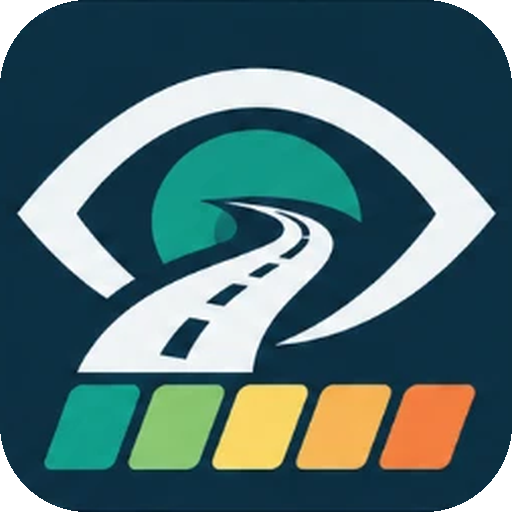

# ArgusVisio – Prototyp

Studentisches Gründungsprojekt von Miranda und Ehab (Mentor: Herr Spannaus).
Infrastruktur-Lagebild für LKW-Routen mit Fahrer-App für Sicherheit und Notfälle.

**Demo starten:** `index.html` im Browser öffnen (Laptop oder Handy). Keine Installation nötig.

- **Flottenzentrale:** `index.html` (oder `index.html#flotte`)
- **Fahrer-App:** `index.html#fahrer` – am besten auf dem Handy
- In der Flottenzentrale zeigt „Fahrer-App daneben“ beide Apps nebeneinander.

## Funktionen

**Flottenzentrale**
- Lagekarte mit 10 Datenquellen: BayernAtlas, Brücken-Zustandsnoten (BASt), Kuppen, Engstellen, Durchfahrtshöhen, Unfallatlas, Baustellen, Drohnen-Geozonen, Tunnelsensoren, Fahrzeugzählung, LKW-Ortung, Rastplätze und Notrufsäulen
- Routenbewertung mit Label A–E, Konfidenz und „schwächstem Glied“; Sicherheitsscore über einen Kalman-Filter mit offenem Rechenweg
- Fahrzeugprofil (Maße, Gewicht, Diesel/Elektro, Temperatur) mit Energie- und Reichweitenrechnung
- Route Re-Planning, auch automatisch bei Tunnelsperrung oder Fahrermeldung
- Gegenlicht-Planer (berechneter Sonnenstand), Streckenbericht als Sorgfaltsnachweis
- Tunnel: Sensoren (CO, Sichttrübe, Temperatur, Luftstrom), Fahrzeugzählung an den Portalen, Durchfahrtswächter mit Meldung an die Flottenleitung
- Notfälle: Standort, Notfallpass, Empfehlung und vorbereiteter Text für den Notruf 112

**Fahrer-App**
- Fahrmodus ohne Karte (nur nächste Gefahren, § 23 StVO); Karte nur im Stand, mit Zoom
- Gefahren melden an Flottenleitung und Fahrer im Umkreis von 15 km
- SOS (2 Sekunden halten), automatische Sicherheitsabfrage bei Aufprall, Stillstand, Tunnel oder Aussteigen-Modus
- Ersthelfer in der Nähe, Erste-Hilfe-Kurzanleitung, Notfallpass
- Pausenkarte mit Rastplätzen, Notrufsäulen, Tankstellen und Läden; Lenkzeit

## Wichtige Hinweise

- **Alle Daten sind Demo-Daten.** Bauwerks-IDs, Zustandsnoten, Sensorwerte, Fahrzeuge, Rastplätze, Tankstellen, Preise und Geometrien sind erfunden. Ortsnamen dienen nur der Orientierung.
- Außerhalb von claude.ai läuft die Demo im Modus „Demo lokal“: Fahrer-App und Flottenzentrale tauschen Meldungen nur im selben Browserfenster aus.
- Ideen für Label A–E, schwächstes Glied, Konfidenz, Gegenlicht-Planer, Streckenbericht und Preismodell stammen aus dem ARGUS-Prototyp des Lehrstuhls.
- Der Score ist eine Einordnung, keine Zusicherung der Gefahrlosigkeit. Die App ruft nie selbst den Notruf an.

## Unterlagen

- `docs/ArgusVisio_Wettbewerbsanalyse.xlsx` – Konkurrenten, Funktionsvergleich, Markenanalyse, SWOT, Quellen
